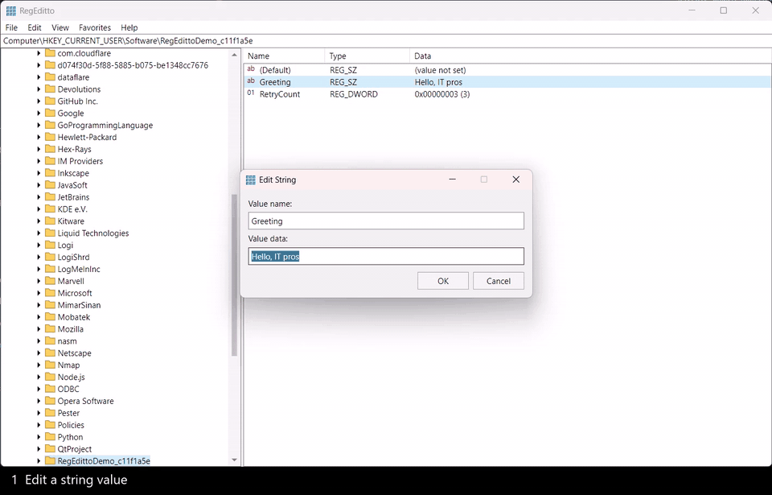

# RegEditto

RegEditto is an independent, compact classic Windows registry editor written
entirely in C# with Avalonia and published as a self-contained NativeAOT
executable.

## Demo

[](docs/regeditto-demo.mp4)

A 30-second demo of editing strings and DWORDs, renaming keys and values,
creating subkeys and values, and deleting a key. The recording was sped up.
[Download the MP4](docs/regeditto-demo.mp4).

## Overview

The presentation follows the compact traditional Registry Editor layout:
normal 12-DIP Segoe UI text, File/Edit/View/Favorites/Help menu, one compact 20.8-DIP
address line, edge-to-edge white panes, a narrow draggable splitter, five hives
under Computer, lazy expansion, 17.6-DIP value rows, resizeable/sortable
Name/Type/Data columns, and compact modal editors. Status bar visibility, window
size, splitter, column widths and sorting, last key, search options and favorites are saved only to
`%LOCALAPPDATA%\RegEditto\settings.json`.

## Build and run

Build from the repository root with PowerShell 7, the .NET SDK pinned in
`global.json`, and the Visual Studio C++ build tools (required by NativeAOT):

```powershell
git clone https://github.com/awakecoding/RegEditto.git
cd RegEditto
pwsh .\build.ps1                               # artifacts\win-x64
pwsh .\build.ps1 -RuntimeIdentifier win-arm64  # artifacts\win-arm64
.\artifacts\win-x64\RegEditto.exe
```

Avalonia comes from the official NuGet packages; versions are pinned in
`Directory.Packages.props`. The build publishes a self-contained NativeAOT
bundle (no JIT or installed .NET runtime required). No installer, elevation,
signing or shell registration is performed. Keep the bundle's files together.
For a development build:

```powershell
dotnet build .\managed\RegistryEditor.csproj -c Release
.\managed\bin\Release\net10.0\RegEditto.exe
```

Settings use source-generated JSON metadata with reflection-based
serialization disabled. ACLUI callbacks use source-generated COM interop rather
than runtime-generated COM wrappers. Trim and AOT warnings fail publishing.
The build replaces only its generated bundle after a successful publish, so
files from older JIT bundles are not carried into deployment.

A registry key path may be supplied as the first command-line argument.
Opening a `.reg` filename displays the import confirmation. `/m` opens another
instance, `/e file.reg [key]` exports Unicode, `/a file.reg [key]` exports legacy
ACP, and `/s file.reg` imports without a confirmation. **`/s` immediately changes
the registry**; failures return exit code 1 and are recorded in
`%LOCALAPPDATA%\RegEditto\error.log`.

### Regedit command-line compatibility

The conventional Windows Regedit syntax is supported (switches are
case-insensitive, accept `/` or `-`, and can be combined or repeated;
quote filenames and keys containing spaces):

```powershell
RegEditto.exe
RegEditto.exe /m
RegEditto.exe "C:\Backups\settings.reg"
RegEditto.exe /s "C:\Backups\settings.reg"
RegEditto.exe /e "C:\Backups\settings.reg" "HKEY_CURRENT_USER\Software\Example"
RegEditto.exe /a "C:\Backups\settings-ansi.reg" "HKEY_CURRENT_USER\Software\Example"
RegEditto.exe /ms "C:\Backups\first.reg" "C:\Backups\second.reg"
```

Import filenames need not end in `.reg`. `/s` with no file opens the editor, as
Regedit does. Omitting the export key exports HKLM
followed by HKCU, matching the conventional Regedit CLI scope (the GUI's All
option still includes all five hives). Silent import never opens an error
dialog, even for malformed arguments; errors are logged and return 1. Multiple
import files are processed in order. Prompted import exits after the dialogs
rather than leaving an editor window open.

This is syntax/data compatibility, not a byte-for-byte substitute for every
undocumented Regedit behavior. Unlike Regedit, this app does not elevate,
always starts its own instance, returns reliable batch failure codes, and
refuses lossy ANSI exports instead of skipping unrepresentable Unicode data.
Key-path launch is an app extension. Unknown switch letters are ignored;
legacy `/l` and `/r` exit without action, and export with no filename or extra
operands exits without exporting. Self-registration `/regserver` and
`/unregserver` is explicitly unsupported. Multiple-file import stops on the first
reported failure rather than hiding partial success. DisableRegistryTools policy
handling, single-instance handoff and Regedit's unusual raw-command-line/tab
tokenization are not emulated; this is not intended to bypass administrative
restrictions or replace the system executable.
Syntax reference: [Regedit command line](https://ss64.com/nt/regedit.html).

The executable embeds an original 16/20/24/32/40/48/64/128/256-pixel icon, reused for
windows and dialogs. `generate-icon.ps1` is its reproducible source; edit the
generator, not the generated `.ico`. Native version/product metadata and an
asInvoker, PerMonitorV2 DPI-aware manifest are embedded too. No shell
associations are installed.

## Operations and safety

**Changes immediately affect the real Windows registry. Export before editing.**
The backend uses the 64-bit registry view and safe owned handles. Native queries
and writes retain the original registry type and exact bytes, including unknown
types. String, expandable string, multi-string, binary, DWORD and QWORD editors
are available; Modify Binary Data preserves the existing type. Numeric editors
support hexadecimal and decimal. Empty entries inside multi-strings are rejected
because they cannot be represented by the Windows multi-string format.

Keys and values can be created, renamed inline and deleted. New creates the next
available `New Key #N` or `New Value #N` and starts inline name editing; Enter
commits and Escape leaves the newly created item with its initial name.
Destructive operations use
confirmation dialogs with No as the default. The default value cannot be
renamed. Existing names are never knowingly overwritten by New/Rename. Refresh,
copy key name, address navigation, favorites, and find/find-next are supported.
Keyboard shortcuts: Ctrl+L address, Ctrl+F find, F3 find-next, F5 refresh,
F2 rename, Delete delete, Ctrl+P print, Enter modify, and Tab between panes. Context menus
provide the same actions.
The binary editor has eight-byte offset/hex/ASCII rows, selection, insert and
overwrite modes, deletion/backspace and clipboard operations. Tab switches hex
and ASCII; Shift+arrows extends the selection. Edits are applied only on OK.
Local key/value/security changes are monitored through native registry
notifications; remote registries retain explicit F5 refresh.

`.reg` import supports Version 5.00 and REGEDIT4 syntax, quoted escapes, DWORD,
all hexadecimal types, continuations, default values, and key/value deletions.
The complete syntax is validated before the first change. Version 5 files may
be UTF-16LE with BOM or valid UTF-8; BOM-less REGEDIT4 files use the system ANSI
code page. Export writes UTF-16LE with BOM, normal quoted strings and DWORD
syntax when lossless, and raw hex for other types and malformed existing values.
Legacy export refuses text that cannot be encoded without loss. Import is not transactional: if a permissions or
other operational failure occurs, the error reports how many operations were
applied and earlier changes remain. Export offers All/Selected Branch and
Unicode `.reg`, legacy `.reg`, binary `.hiv` or text formats. Remote `.reg`
snapshots are explicitly rebased onto local hive paths and warn that importing
them affects the importing computer. File export failures do not publish a
partially written `.reg` or `.hiv` file.

Connect Network Registry uses the native remote registry API and presents HKLM
and HKU. The remote Registry service, network access and account permissions
must already allow it. Offline hive load/unload uses the native APIs with the
process's **existing** privileges; importing a `.hiv` replaces the selected local
subkey only after confirmation. The app never enables privileges, requests
UAC, or changes system security configuration. Those operations may return
access denied. Runtime validation does not exercise them.

Permissions opens Windows' native ACLUI basic and advanced DACL/owner editor.
Write controls reflect the current account's access; no privileges are enabled.
Printing uses the native printer dialog and a paginated GDI report of the
selected branch on a dedicated STA thread. The dialog has no cross-thread
owner HWND; the main application is disabled until it returns, avoiding modal
activation deadlocks while keeping the application dispatcher responsive.
Native permissions and print-dialog opening/cancellation are verified.
Actual printed output and ACL/owner writes remain unverified: validation never
submits a print job, applies security changes, or changes printer settings.
Find continues from the selected branch through subsequent siblings and hives
by default, with an optional selected-branch-only checkbox. Escape cancels;
the next search continues after the last key/value match.

## Remaining parity limitations

This is not full Regedit parity or a pixel-identical Win32 renderer. Glyphs,
selection visuals, menus and dialogs are independently drawn Avalonia controls.
The hex grid is independently implemented rather than a Win32 control, and has
no per-byte accessibility peers. Native advanced auditing/effective-access
pages, recursive owner replacement, resource-descriptor-specific editors,
address autocomplete, print preview/page setup, shell file associations, and
complete localization are not implemented. Registry files selected under
another extension are interpreted as text rather than automatically detecting
binary hive format. The app uses the 64-bit registry view and does not elevate;
operations that require privileges not already enabled may fail.
Find stops with an explicit error on inaccessible keys instead of silently
skipping them. Import/CRUD has no transaction or undo.

## Validation

```powershell
dotnet test --project .\tests\RegistryEditor.Backend.Tests.csproj -c Release
dotnet test --project .\tests\ui\RegistryEditor.UI.Tests.csproj -c Release
pwsh .\tests\test-bundle.ps1 -ParityWorkflows -ScreenshotPath "$env:TEMP\registry-editor-csharp.png"
```

The backend tests link only the backend sources and use Microsoft.Testing.Platform.
Each real-registry fixture creates a unique
`HKCU\Software\RegEditto.Tests.<pid>.<guid>` subtree and deletes
only that subtree on disposal. No existing registry entries are edited.
The UI regression covers null content during report-list recycling, inline
rename commit/cancel and hex/ASCII keyboard editing; parser tests cover
command-line modes without executing registry writes. The bundle
smoke test verifies that no JIT CLR is loaded or stale managed application DLL
remains, renders six value types in its own temporary HKCU subtree, captures
the window through Cua Driver, selects Computer again, closes the app normally,
and removes only its fixture. Parity workflows also verify isolated command-line
export/import, automatic refresh, native permissions cancellation and
binary-editor cancellation with unchanged bytes. They also require native
print-dialog cancellation without submitting a job.
Cua Driver must already be installed and available
for that optional GUI test.

## License

RegEditto is licensed under the [MIT License](LICENSE).
